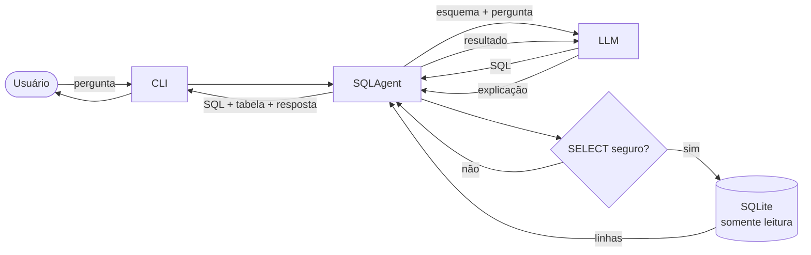

# Agente de IA para Consultas SQL

[](https://www.python.org/)
[](https://www.sqlite.org/)
[](#testes)
[](LICENSE)

Agente que recebe perguntas em **linguagem natural**, gera **SQL** com um LLM, valida a consulta e devolve o resultado em uma tabela — com uma explicação em português.

Projeto desenvolvido como entrega do desafio **"Desenvolvimento de um agente de IA capaz de converter perguntas em linguagem natural em consultas SQL"** da [DIO](https://www.dio.me/).

---

## Sumário

- [Sobre o desafio](#sobre-o-desafio)
- [O que o projeto faz](#o-que-o-projeto-faz)
- [Arquitetura](#arquitetura)
- [Estrutura do repositório](#estrutura-do-repositório)
- [Como executar](#como-executar)
- [Configuração do LLM](#configuração-do-llm)
- [Banco de exemplo](#banco-de-exemplo)
- [Uso](#uso)
- [Exemplo de saída](#exemplo-de-saída)
- [Como funciona](#como-funciona)
- [Segurança](#segurança)
- [Testes](#testes)
- [Decisões técnicas](#decisões-técnicas)
- [Limitações](#limitações)
- [Aprendizados](#aprendizados)
- [Próximos passos](#próximos-passos)
- [Licença](#licença)

---

## Sobre o desafio

O objetivo é aplicar, em um projeto prático, os conceitos de **engenharia de prompt**, **integração com LLMs** e **documentação técnica**, construindo um agente que traduz perguntas de negócio em consultas SQL.

Além do código, este repositório documenta o processo de desenvolvimento no [diário de bordo](docs/diario-de-bordo.md), incluindo decisões, dificuldades e aprendizados.

## O que o projeto faz

- Converte perguntas em português para **SQLite SQL**.
- Lê o **esquema do banco automaticamente** (tabelas, colunas, tipos e chaves estrangeiras) e o envia no prompt — o modelo não precisa "adivinhar" a estrutura.
- **Valida** a consulta e garante que apenas leituras (`SELECT` / `WITH ... SELECT`) sejam executadas.
- **Corrige sozinho**: se a consulta falhar, o erro do banco volta para o modelo, que tem até 2 novas chances.
- Limita o número de linhas retornadas e sinaliza quando o resultado foi truncado.
- Gera uma **explicação em linguagem natural** com base apenas no resultado obtido.
- Funciona com **OpenAI, Groq, Gemini, OpenRouter ou Ollama local**, pois usa a API compatível com OpenAI.
- Oferece modo **interativo**, pergunta única, saída em **JSON** e comandos para inspecionar o esquema.

## Arquitetura



O fluxo é um **loop com autocorreção**: o SQL gerado é validado e executado; se houver erro, a mensagem do banco é enviada de volta ao modelo antes da próxima tentativa.

## Estrutura do repositório

```text
.
├── sql_agent/
│   ├── __init__.py          # exporta a API pública do pacote
│   ├── __main__.py          # permite `python -m sql_agent`
│   ├── agent.py             # orquestração, extração de SQL e retentativas
│   ├── cli.py               # interface de linha de comando e tabelas ASCII
│   ├── config.py            # configuração via .env / variáveis de ambiente
│   ├── database.py          # conexão somente leitura + introspecção + validação
│   ├── llm.py               # cliente para APIs compatíveis com OpenAI
│   ├── prompts.py           # prompts de geração de SQL e de explicação
│   └── sample_data.py       # criação do banco de demonstração
├── scripts/
│   └── create_sample_db.py  # cria data/empresa.db
├── tests/
│   ├── conftest.py          # fixtures e LLM falso (stub)
│   ├── test_agent.py        # pipeline, retentativas, extração de SQL
│   ├── test_cli.py          # saída em texto/JSON e --show-schema
│   └── test_database.py     # esquema, validação e proteção contra escrita
├── docs/
│   └── diario-de-bordo.md   # registro do processo de desenvolvimento
├── data/                    # banco gerado (fora do controle de versão)
├── .env.example
├── requirements.txt
├── requirements-dev.txt
└── README.md
```

## Como executar

### Pré-requisitos

- Python **3.10+**
- Uma chave de API de um provedor de LLM **ou** [Ollama](https://ollama.com/) rodando localmente

### Passo a passo

```powershell
# 1. Clone o repositório e entre na pasta
git clone https://github.com/SEU-USUARIO/agente-sql-dio.git
cd agente-sql-dio

# 2. Crie e ative um ambiente virtual (Windows/PowerShell)
python -m venv .venv
.\.venv\Scripts\Activate.ps1

# Linux/macOS:
# python -m venv .venv
# source .venv/bin/activate

# 3. Instale as dependências
pip install -r requirements.txt

# 4. Configure o provedor
Copy-Item .env.example .env      # Linux/macOS: cp .env.example .env
# edite o .env com a sua chave e modelo

# 5. Crie o banco de demonstração
python scripts/create_sample_db.py

# 6. Converse com o agente
python -m sql_agent
```

> No Windows, se os acentos aparecerem estranhos no terminal, execute `chcp 65001` antes de rodar o agente.

## Configuração do LLM

O agente usa o SDK `openai` apontando para qualquer serviço **compatível com a API de chat completions**. Basta ajustar `LLM_BASE_URL` e `LLM_MODEL`.

| Variável | Padrão | Descrição |
| --- | --- | --- |
| `SQL_AGENT_DB` | `data/empresa.db` | Caminho do arquivo SQLite |
| `SQL_AGENT_MAX_ROWS` | `100` | Máximo de linhas devolvidas por consulta |
| `SQL_AGENT_MAX_RETRIES` | `2` | Tentativas extras de correção do SQL |
| `LLM_MODEL` | `gpt-4o-mini` | Nome do modelo no provedor |
| `LLM_API_KEY` | — | Chave de API (Ollama aceita qualquer valor) |
| `LLM_BASE_URL` | — | URL base do provedor (vazio para OpenAI) |
| `LLM_TEMPERATURE` | `0` | Temperatura da geração |

<details>
<summary><strong>OpenAI</strong></summary>

```env
LLM_MODEL=gpt-4o-mini
LLM_API_KEY=sk-...
LLM_BASE_URL=
```
</details>

<details>
<summary><strong>Groq</strong></summary>

```env
LLM_MODEL=llama-3.3-70b-versatile
LLM_API_KEY=gsk_...
LLM_BASE_URL=https://api.groq.com/openai/v1
```
</details>

<details>
<summary><strong>Google Gemini</strong> (endpoint compatível com OpenAI)</summary>

```env
LLM_MODEL=gemini-2.0-flash
LLM_API_KEY=sua-chave-do-google-ai-studio
LLM_BASE_URL=https://generativelanguage.googleapis.com/v1beta/openai/
```
</details>

<details>
<summary><strong>Ollama</strong> (local, sem custo por token)</summary>

```powershell
ollama pull qwen2.5-coder:7b
```

```env
LLM_MODEL=qwen2.5-coder:7b
LLM_API_KEY=ollama
LLM_BASE_URL=http://localhost:11434/v1
```
</details>

<details>
<summary><strong>OpenRouter</strong></summary>

```env
LLM_MODEL=meta-llama/llama-3.3-70b-instruct
LLM_API_KEY=sk-or-...
LLM_BASE_URL=https://openrouter.ai/api/v1
```
</details>

> Nunca versione o arquivo `.env`: ele já está no `.gitignore`.

## Banco de exemplo

O script `scripts/create_sample_db.py` cria um banco SQLite determinístico (semente `2026`) com dados de uma empresa fictícia:

| Tabela | Registros | Conteúdo |
| --- | ---: | --- |
| `clientes` | 40 | nome, e-mail, cidade/UF, segmento, data de cadastro |
| `vendedores` | 6 | nome, e-mail, região |
| `produtos` | 25 | nome, categoria, preço, estoque |
| `pedidos` | 120 | cliente, vendedor, data, status, canal |
| `itens_pedido` | 289 | pedido, produto, quantidade, preço unitário |

Os pedidos cobrem **janeiro/2025 a novembro/2026** e cinco clientes não possuem pedidos — o que permite testar agregações, filtros por data, `JOIN`, `NOT EXISTS` e `LEFT JOIN`.

Categorias disponíveis: `Eletrônicos`, `Móveis`, `Livros`, `Esportes` e `Casa`.

## Uso

### Modo interativo

```powershell
python -m sql_agent
```

```text
pergunta> Quais foram os 5 clientes que mais gastaram em 2026?
```

Comandos disponíveis no modo interativo:

| Comando | Ação |
| --- | --- |
| `/ajuda` | Mostra a ajuda |
| `/schema` | Exibe o esquema do banco |
| `/sair` | Encerra o programa |

### Pergunta única

```powershell
python -m sql_agent -q "Qual o faturamento por categoria em 2026?"
```

### Saída em JSON (para integrar com outros sistemas)

```powershell
python -m sql_agent -q "Quantos pedidos foram entregues?" --json --no-explain
```

```json
{
  "pergunta": "Quantos pedidos foram entregues?",
  "sql": "SELECT COUNT(*) AS total FROM pedidos WHERE status = 'entregue'",
  "explicacao": null,
  "tentativas": 1,
  "colunas": ["total"],
  "linhas": [{ "total": 52 }],
  "total_linhas": 1,
  "truncado": false,
  "tempo_ms": 0.21,
  "avisos": []
}
```

### Outras opções

```powershell
python -m sql_agent --db data/empresa.db --show-schema   # imprime o esquema e sai
python -m sql_agent -q "..." --max-rows 20               # limita o resultado
python -m sql_agent -q "..." --max-retries 0             # desativa autocorreção
python -m sql_agent --help
```

### Exemplos de perguntas

- Quais foram os 5 clientes que mais gastaram em 2026?
- Qual o faturamento por categoria, considerando apenas pedidos não cancelados?
- Qual vendedor teve o maior número de pedidos entregues no último ano?
- Quais clientes nunca fizeram pedidos?
- Qual o ticket médio dos pedidos feitos pelo site?
- Quais produtos estão com estoque abaixo de 20 unidades?
- Qual a evolução mensal do faturamento em 2026?
- Qual cidade concentra mais clientes do segmento Tecnologia?

## Exemplo de saída

```text
pergunta> Quais foram os 5 clientes que mais gastaram em 2026?

SQL gerado (tentativa 1):
  SELECT c.nome,
         ROUND(SUM(i.quantidade * i.preco_unitario), 2) AS total_gasto
  FROM clientes c
  JOIN pedidos p ON p.cliente_id = c.id
  JOIN itens_pedido i ON i.pedido_id = p.id
  WHERE p.status <> 'cancelado'
    AND strftime('%Y', p.data_pedido) = '2026'
  GROUP BY c.id, c.nome
  ORDER BY total_gasto DESC
  LIMIT 5

Resultado: 5 linha(s) em 0.64 ms
+-----------------+-------------+
| nome            | total_gasto |
+-----------------+-------------+
| Diego Almeida   | 45775.45    |
| Isabela Dias    | 43512.35    |
| Mariana Ribeiro | 32710.28    |
| Rafael Honda    | 25864.69    |
| Rafael Klein    | 19588.9     |
+-----------------+-------------+

Resposta: Os cinco clientes que mais gastaram em 2026 foram Diego Almeida,
Isabela Dias, Mariana Ribeiro, Rafael Honda e Rafael Klein, somando juntos
cerca de R$ 167 mil em pedidos não cancelados.
```

> Os nomes e valores acima vêm do banco de exemplo. A explicação final é gerada pelo modelo a partir da tabela de resultados.

## Como funciona

1. **Introspecção do esquema** — `Database.schema()` lê o `sqlite_master`, os `PRAGMA table_info` e as chaves estrangeiras e monta um texto pronto para o prompt.
2. **Geração do SQL** — o `SQLAgent` envia ao LLM um system prompt com regras rígidas (apenas `SELECT`, nomes reais, datas em ISO, `LIMIT` para "top N") e a pergunta do usuário.
3. **Extração** — `extract_sql()` remove cercas de markdown, prefixos como `SQL:` e texto ao redor da consulta.
4. **Validação e execução** — `validate_sql()` bloqueia qualquer coisa que não seja leitura e o `Database` executa com limite de linhas.
5. **Autocorreção** — se a execução falhar, a mensagem de erro volta ao modelo junto com a pergunta; o ciclo se repete até `SQL_AGENT_MAX_RETRIES`.
6. **Explicação** — com o resultado em mãos, uma segunda chamada ao LLM produz uma resposta curta em português, restrita aos dados retornados.

## Segurança

Um LLM pode gerar comandos destrutivos por engano (ou por *prompt injection* em dados). O projeto aplica defesa em camadas:

| Camada | Proteção |
| --- | --- |
| **Validação textual** | Aceita apenas uma instrução iniciada por `SELECT`/`WITH`; rejeita `INSERT`, `UPDATE`, `DELETE`, `DROP`, `ALTER`, `PRAGMA`, `ATTACH` etc., ignorando o conteúdo de literais e comentários |
| **Conexão somente leitura** | O arquivo é aberto com URI `?mode=ro`, então o próprio SQLite recusa escritas |
| **`PRAGMA query_only` + authorizer** | A conexão nega qualquer ação que não seja `SELECT`, `READ`, `FUNCTION` ou `RECURSIVE` |
| **Limite de linhas** | `fetchmany(max_rows + 1)` evita carregar tabelas inteiras na memória e sinaliza truncamento |

Nenhuma dessas camadas substitui *permissões de banco bem configuradas*. Em produção, use um usuário com acesso apenas de leitura e considere limites de custo/tempo no provedor de LLM.

## Testes

```powershell
pip install -r requirements-dev.txt
python -m pytest -q
```

```text
40 passed
```

Os testes usam um **LLM falso** (stub), portanto rodam **sem rede e sem custo de API**. A cobertura inclui:

- introspecção de esquema e listagem de tabelas;
- validação de SQL seguro (incluindo palavras perigosas dentro de strings);
- recusa de escrita pela conexão somente leitura;
- limite e truncamento de resultados;
- caminho feliz do agente (SQL + explicação);
- autocorreção após erro do banco e após resposta em texto puro;
- extração de SQL em blocos markdown e com texto ao redor;
- garantia de que consultas destrutivas **nunca** são executadas;
- falha na explicação sem perder o resultado;
- CLI em modo texto, JSON e `--show-schema`.

## Decisões técnicas

- **SQLite para a demonstração**: não exige servidor, deixa o projeto reproduzível com um comando e mantém o foco no que importa — o fluxo pergunta → SQL → validação → resposta. A camada de banco é isolada, então trocar por PostgreSQL é viável.
- **API compatível com OpenAI**: um único cliente atende OpenAI, Groq, Gemini, OpenRouter e Ollama, reduzindo acoplamento e permitindo usar modelos locais.
- **Esquema no prompt em vez de *fine-tuning***: é simples, auditável e se adapta a qualquer banco sem treinar nada.
- **Validação fora do LLM**: segurança não pode depender do humor do modelo; a checagem é determinística e testável.
- **Autocorreção com o erro real do banco**: mensagens como `no such column` são o melhor *feedback* possível para o modelo.
- **`LLMClient` como protocolo**: o agente depende de uma interface mínima, o que permite testar todo o pipeline com um stub.
- **Limite via `fetchmany`**: não injeta `LIMIT` na consulta do usuário, preservando a semântica de `ORDER BY`, `LIMIT`/`OFFSET` e subconsultas.

## Limitações

- Dialeto **SQLite**; para outro banco é preciso ajustar o prompt e a camada de conexão.
- O esquema é lido na abertura da conexão; mudanças estruturais durante a sessão exigem reiniciar o agente.
- A qualidade depende do modelo escolhido — modelos pequenos erram mais nomes de colunas.
- Não há memória entre perguntas: cada pergunta é independente.
- O limite de linhas protege a memória, mas não impede consultas caras; em bases grandes, configure *timeouts* no banco.
- A explicação pode falhar (ex.: limite de requisições) sem invalidar o resultado; o aviso aparece no terminal.

## Aprendizados

- **O esquema é parte do prompt.** Quanto mais explícitos nomes, tipos e relacionamentos, menor a taxa de alucinação.
- **Validar é diferente de confiar.** O modelo propõe; o código dispõe. Camadas determinísticas são o que tornam o uso seguro.
- **Erro do banco é contexto útil.** Devolver a mensagem real ao modelo resolveu a maioria das falhas de sintaxe/coluna na segunda tentativa.
- **Extração robusta importa.** Modelos adoram responder com cercas de markdown e explicações; normalizar a saída antes de validar evitou retentativas desnecessárias.
- **Testar sem API é possível** ao depender de uma interface (`LLMClient`) em vez do SDK concreto.
- **Documentar faz parte do projeto.** Registrar decisões e dificuldades transforma o código em algo que outra pessoa consegue manter.

O processo completo está em [`docs/diario-de-bordo.md`](docs/diario-de-bordo.md).

## Próximos passos

- [ ] Suporte a PostgreSQL/MySQL com dialeto configurável.
- [ ] Memória de conversa para perguntas de acompanhamento ("e em 2025?").
- [ ] Catálogo semântico (descrições de colunas e métricas de negócio) no prompt.
- [ ] Avaliação automatizada com um conjunto de perguntas e SQLs esperados.
- [ ] Interface web (Streamlit) com histórico e download em CSV.
- [ ] *Guardrails* de custo e *timeout* por consulta.
- [ ] Gráficos automáticos quando o resultado for temporal.

## Licença

Distribuído sob a licença MIT. Veja [LICENSE](LICENSE).

---

Feito com dedicação para o desafio da DIO.
